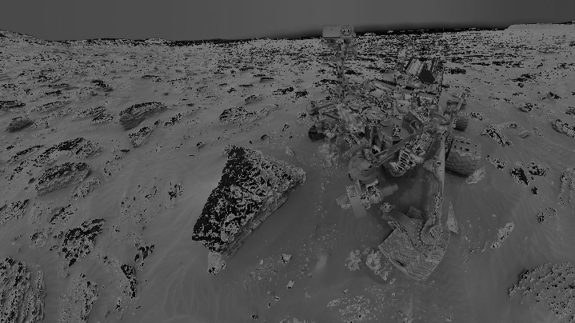
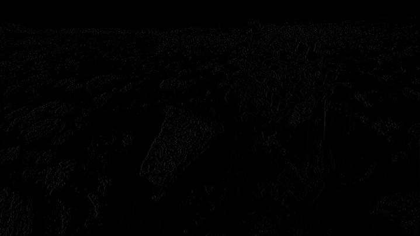
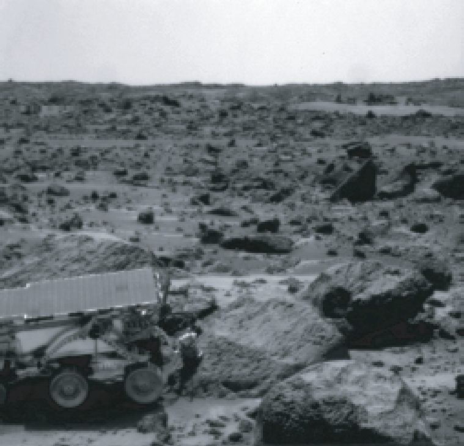
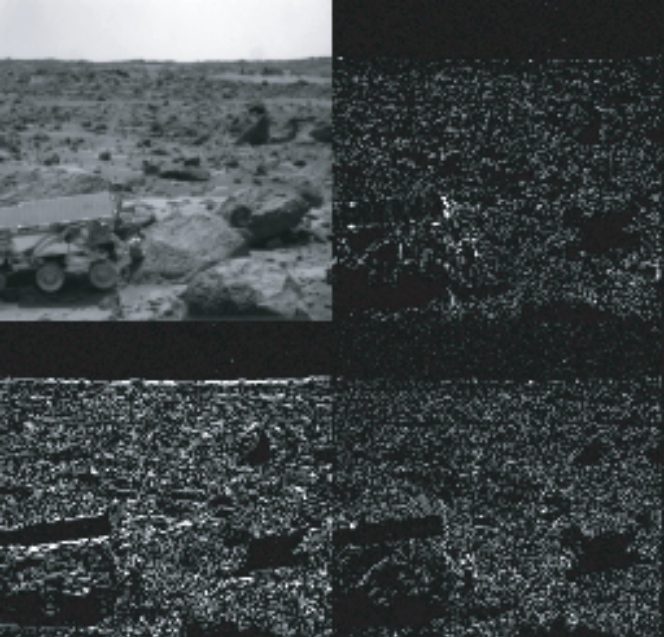
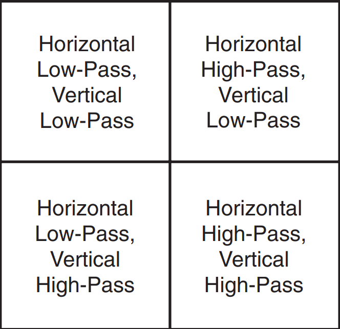

# A Reference for Implementing Algorithms in Publications - ICER Image Compression via Wavelet Transformation

Unless their work incorporates research in some form, many software engineers, data scientists, developers won't know where to begin if they decide, or have to, translate a concept for some algorithm, architecture or other process from research papers to a fully functioning program. If you're not already experienced in the field behind a publication, they will come off as dense, jargon heavy and unreadable due to the general consensus from the authors that anyone reading the paper will be fully up to date with every concept that is not the topic of the paper (i.e. they are not self-contained). 

However, this is less of a problem when the reader is intending to implement the resource. This may sound counter-intuitive at first, but converting these concepts into programs requires breaking the concept down into implementable sub-components. From here, the reader can focus on understanding the concepts behind each of these components separately. This provides concrete direction on what needs to be researched, why it is needed for the program to function and how it'll eventually be implemented.

## What paper will be used?

In this repository, we will be going over the ["The ICER Progressive Wavelet Image Compressor"](https://ipnpr.jpl.nasa.gov/progress_report/42-155/155J.pdf) algorithm developed by NASA JPL.

## Why this paper?

This project will hopefully cover the process for handling large, complex publications and should be applicable to much lighter versions. The paper we're referencing is a hefty 46 pages (43 without references), utilizes distinct concepts and discusses the stages of the algorithm along with the theoretical foundations of these stages. 

# ICER Image Compression using Wavelet Transformation in Python

This repository will not only be acting as a guide or reference, but it will, of course, contain a fully implemented version of the algorithm and also contain the standard information in a GitHub repository to demonstrate both, the implementation and presentation of a translated algorithm.

## Background
At the time of development, the only available implementation of the ICER progressive wavelet image compression technique is in C. Of course, this is done in C with memory constraints in mind as this algorithm is originally for NASA exploration hardware. However, for readability, accesibility and modernity purposes, this version implements this technique in Python.

_Here is the implementation task list:_

- [x] Step 1: Wavelet Transformations
  - [x] One-Dimensional Wavelet Transformation
    - [x] Low-pass Filter Implementation
    - [x] High-pass Filter Implementation
  - [x] Two-Dimensional Wavelet Transformation
    - [x] Multi-level Decomposition
- [x] Steps 2: Bit-Plane Coding
  - [x] Bit-Plane Construction
    - [x] Pixel Binarization
  - [x] Categorization
  - [x] Context Modelling
  - [x] Encoding Prioritzation
  - [x] Encoding Optimization
- [x] Step 3: Entropy Coding
- [x] Step 4: Image Quality and Compression Controlling

The implementation supports grayscale image compression and reconstruction, including exact lossless round trips, progressive lossy compression, all seven wavelet filters, and the paper's 17-bin interleaved entropy coder. The saved `.icerpy` files use this project's own versioned header, not NASA's flight bitstream format. Compression currently uses a single segment and maintains probability counts per subband; independent error-containment segments from Section V of the paper are not implemented.

## Quick Links
_Note: Equations are in LateX which does not display properly in the official GitHub mobile app_

- [How does Wavelet Transformation Work?](https://github.com/dsmith111/ICER-Python/blob/master/ICERPython/Wavelets/README.md)
- [How does Bit-plane Coding Work?](https://github.com/dsmith111/ICER-Python/blob/master/ICERPython/BitPlaneCoding/README.md)
- [How does Entropy Coding Work?](./ICERPython/EntropyCoding/README.md)

## Installation
Clone the repository:

```bash
git clone https://github.com/dsmith111/ICER-Python.git
cd ICER-Python
```

Install the required dependencies:
```bash
pip install -r requirements.txt
```
## Usage
The main script for compressing and reconstructing images is `compress_image.py`.

### Command Line Arguments

`compress_image.py` accepts the following command line arguments:

- `-i`, `--input_image`: Path to the input image file that you want to compress.
- `-o`, `--output_image`: Prefix for the compressed file and decomposed image files. When decompressing, this is the reconstructed image path.
- `-l`, `--levels`: (Optional) Number of wavelet decomposition levels. Default value is `1`.
- `-b`, `--bitrate`: (Optional) Target bits per input pixel when using `--lossy`. Default value is `0.5`.
- `-f`, `--filter`: (Optional) Wavelet filter to use for compression. Default value is `"A"`.
- `--filter_parameters`: (Optional) Path to the filter parameters JSON file. Defaults to the `filter_parameters.json` beside the script.
- `--lossless`: (Optional) Select lossless compression explicitly. Lossless compression is the default when no lossy controls are supplied.
- `--lossy`: (Optional) Enable the bitrate target.
- `--minimum_loss`: (Optional) Quality goal expressed as a minimum number of omitted level-1 HH bit planes. Other subbands are weighted according to their importance. Default value is `0`.
- `--byte_quota`: (Optional) Approximate entropy payload byte quota. When a bitrate is also supplied, the smaller quota is used.
- `--decompress`: (Optional) Reconstruct an image from a `.icerpy` file. The file stores the filter parameters needed for reconstruction.
- `--allow_partial`: (Optional) Permit decompression of a truncated entropy payload. The file header must remain intact.
- `--no_previews`: (Optional) Skip saving the decomposed wavelet images.

#### Example Usage

To compress an image using the ICER algorithm with the default parameters, run the following command:

```bash
python3 compress_image.py -i path/to/input/image.jpg -o path/to/output/image_prefix -f A
```
This command will perform lossless compression, save `path/to/output/image_prefix.icerpy`, and save decomposed PNG images beneath `path/to/output/A/`.

The decomposed images will have filenames like `image_prefix_level1_LL.png` and `image_prefix_level1_HH.png`. These are 8-bit visualizations; the compressed file retains the signed integer coefficients.

To reconstruct the image:

```bash
python3 compress_image.py --decompress -i path/to/output/image_prefix.icerpy -o path/to/output/reconstructed.png
```

To compress progressively with a bitrate target and three decomposition levels:

```bash
python3 compress_image.py --lossy -b 0.5 -l 3 -i path/to/input/image.jpg -o path/to/output/lossy_prefix
```

To set a quality goal without a bitrate target:

```bash
python3 compress_image.py --minimum_loss 2 -l 3 -i path/to/input/image.jpg -o path/to/output/quality_prefix
```

As in Section VI of the paper, the quota is checked between subband bit planes, before flushing the entropy coder. The final payload can exceed the quota, and the file header is additional overhead. A target bitrate is therefore not a strict final-file size limit. Missing lower bit planes are reconstructed using the paper's deadzone quantizer; the LL mean is stored separately so a reconstruction is still available when no planes fit.

_Note_: The command line converts input images to 8-bit grayscale. Lossless reconstruction refers to these grayscale samples, not to the original color data or the original image file's bytes.

### Python Usage

`ICER.lossless_compression(levels)` and `ICER.lossy_compression(bitrate, levels, minimum_loss, byte_quota)` return the decomposed subbands, preserving the original interface. The compressed file bytes are available as `icer.encoded_bit_stream`. Pass these bytes to `icer.decompression(...)` to obtain the reconstructed integer image array. `allow_partial=True` enables reconstruction from an intact header followed by a shortened payload.

## Project Structure
The project is organized into the following directories:

- `ICERPython`: Contains the main ICER algorithm implementation and the wavelet transform classes.
   - `Wavelets`: Contains the wavelet filter and transform classes, as well as the filters (low-pass and high-pass) used in the wavelet transform.
      - `WaveletFilter.py`
      - `WaveletTransform.py`
      - `Filters`: Contains the low-pass and high-pass filter classes.
         - `HighPassFilters.py`
         - `LowPassFilters.py`
   - `BitPlaneCoding`: Contains the classes and methods related to bit-plane coding.
      - `BitPlaneEncoder.py`: Implements the bit-plane encoding process.
      - `BitPlaneDecoder.py`: Implements the bit-plane decoding process.
      - `ContextModel.py`: Contains the context modeling methods for bit-plane coding.
        - Also contains the values needed for the zero probability estimation used in the entropy coding process.
   - `ICER.py`: Main ICER implementation, integrating all the components (Wavelets, BitPlaneCoding, etc.).
  - `EntropyCoding`: Contains the interleaved entropy encoder and decoder, along with its explanation.

- `tests`: Contains the regression tests for the individual stages and the complete compression workflow.


The main script for compressing images is `compress_image.py`.

## Results
### Wavelet Transformation
The first step in the ICER algorithm is the break down images based on wavelet decomposition. The major note here as to why this is important when compared to other compression algorithms is the full image data compression rather than performing compression region by region. In the event of data transmission failure, most images would simply not have a region of the image; in this case, we are setting up the rest of the algorithm to allow us to send much lower fidelity full images. This allows us to have a better guarantee of receiving a full image with the cost of fidelity incase of any failures.

Here is a comparison of this algorithm's decomposition vs the results in the paper:

#### Python ICER

**Original Image**


**Decomposed Images**

Horizontal Low-pass, Vertical Low-pass   |  Horizontal Low-pass, Vertical High-pass
:-------------------------:|:-------------------------:
  |  

### NASA ICER

**Original Image**



**Decomposed Images**

Decomposed Images  |  Labels
:-------------------------:|:-------------------------:
  |  

_These images were taken directly from the research paper, hence the lower resolution_

These checked-in Python plots were generated by the earlier implementation and illustrate the decomposition process. The current integer rounding and boundary handling are validated by the regression tests; these historical visual comparisons are not a numerical correctness test.

### Compression and Reconstruction

The checked-in `original_images/rover.jpg`, converted to 810 x 1440 grayscale samples, was tested with filter A and three decomposition levels:

| Mode | Compressed File Size | Reconstruction |
| ---- | ---- | ---- |
| Lossless | 557,525 bytes | Exact grayscale sample match |
| Lossy, 0.5 bits/pixel target, minimum loss 2 | 85,281 bytes | Mean squared error 25.37 |

These sizes include the ICER-Python header. The lossy quota is approximate, as described above. Results depend on image content, filter selection, and decomposition levels.

**Reconstructed Image**


## Contributing
Contributions are welcome! If you find any issues or have suggestions for improvements, please open an issue or submit a pull request.
